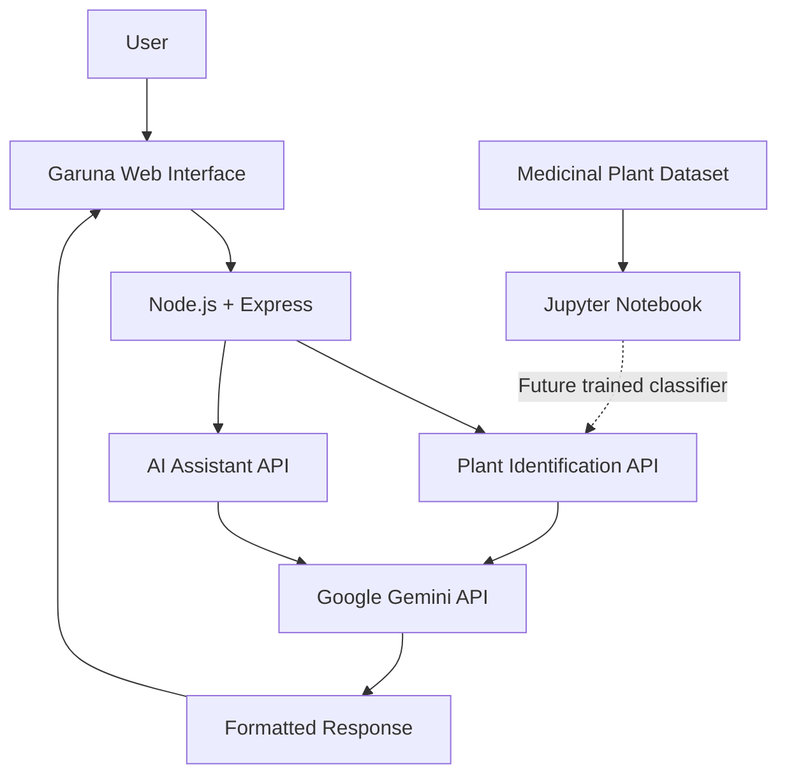

# 🌿 Garuna — AI-Powered Plant Identification

<p align="center">
  <strong>Discover Plants. Explore Nature. Learn with AI.</strong>
</p>

<p align="center">
  
  
  
  
</p>

## 🌱 About Garuna

**Garuna** is an AI-powered botanical discovery website designed to make plant identification and plant knowledge accessible through an intuitive, nature-inspired interface.

The project combines web technologies, AI-powered image analysis, an interactive plant library, and a conversational assistant. It also includes a medicinal plant image dataset for developing a custom machine-learning classification model.

## ✨ Key Features

- 📸 **AI Plant Identification:** Upload a plant image and receive an AI-generated identification response.
- 🤖 **Intelligent Plant Assistant:** Ask questions about plant names, characteristics, habitats, and traditional uses.
- 🌿 **Plant Library:** Browse plant information using a dedicated library interface.
- 🔍 **Search and Filtering:** Find plants through search and category filters.
- 💬 **Interactive Suggestions:** Ask the assistant questions using clickable prompts.
- 🎨 **Responsive Botanical UI:** Clean green-and-cream styling with plant cards and a mobile-friendly layout.
- 🔐 **Secure API Configuration:** Store API credentials in server-side environment variables.
- 🧠 **Machine Learning Development:** Prepare a medicinal plant image dataset for a custom classifier.

## 🛠️ Technology Stack

| Technology | Usage |
|---|---|
| HTML5 | Website structure |
| CSS3 | Styling and responsive design |
| JavaScript | Frontend interactions and API requests |
| Node.js | Backend runtime |
| Express.js | API routes and web server |
| Multer | Image upload handling |
| Google Gemini API | Current plant-identification and assistant responses |
| Marked | Markdown response formatting |
| DOMPurify | Sanitizing formatted HTML |
| Python | ML experimentation |
| Jupyter Notebook | Dataset exploration and model training |
| Hugging Face Datasets | Medicinal plant dataset source |
| Render | Web application hosting |

## 🏗️ Application Architecture



## 🧠 Medicinal Plant Dataset

Garuna's ML development uses the **DIMPSAR Medicinal Plant Classification** dataset.

**Dataset:** [Project-AgML on Hugging Face](https://huggingface.co/datasets/Project-AgML/DIMPSAR_medicinal_plant_classification)

| Dataset detail | Information |
|---|---|
| Task | Medicinal plant image classification |
| Number of images | 5,945 |
| Number of classes | 40 |
| Format | Parquet |
| Approximate download size | 265 MB |
| Development tool | Jupyter Notebook |

The dataset supports experiments in image classification using labelled plant images. The downloaded Parquet file is stored locally and should not be pushed into the normal application repository.

## ⚙️ Run Garuna Locally

### Prerequisites

- Node.js and npm
- Git
- Google Gemini API key

### Installation

Clone the repository:

```bash
git clone https://github.com/YOUR_USERNAME/YOUR_REPOSITORY.git
cd YOUR_REPOSITORY
```

Install dependencies:

```bash
npm install
```

Create a `.env` file in the project root:

```env
GEMINI_API_KEY=your_api_key_here
```

Start the application:

```bash
node server.js
```

Open `http://localhost:3000` if the server is configured to use port 3000.

**Security:** Never commit your actual `.env` file or API key to GitHub.

## ☁️ Deployment

Garuna's Node.js backend can be hosted as a Render Web Service.

| Setting | Value |
|---|---|
| Runtime | Node |
| Root Directory | Blank, if files are in the repository root |
| Build Command | `npm install` |
| Start Command | `node server.js` |
| Environment Variable | `GEMINI_API_KEY` |

Configure the API key privately in Render's Environment settings.

## 📊 Model Evaluation

Garuna currently uses the Gemini API for its AI-powered website features. The separate custom ML model is being developed using the medicinal plant dataset.

| Evaluation metric | Result |
|---|---|
| Dataset selected | DIMPSAR Medicinal Plant Classification |
| Dataset format | Parquet |
| Custom model training | Not yet confirmed complete |
| Test accuracy | Not measured yet |
| Precision and recall | Not measured yet |

The custom model's performance should be reported after training and evaluation on a held-out test dataset. This ensures that reported accuracy represents actual model performance rather than an estimated or invented score.

## 🚀 Project Goals

Garuna brings together botanical information, web development, generative AI, and machine learning in a single project. Its goal is to provide an accessible platform for exploring plants while creating a foundation for a future custom plant-classification model.

## 🔒 Responsible Use

AI-based plant identification can make mistakes. Results are intended for educational purposes and should not be used alone to decide whether a plant is edible, medicinal, or safe to handle.

## 📚 Dataset Reference

**DIMPSAR Medicinal Plant Classification**

[View the dataset and license details](https://huggingface.co/datasets/Project-AgML/DIMPSAR_medicinal_plant_classification)

Check the dataset license and attribution conditions before redistributing the dataset or derived material.

---

<p align="center">
  <strong>🌿 Garuna — Connecting Nature, AI, and Machine Learning.</strong>
</p>
